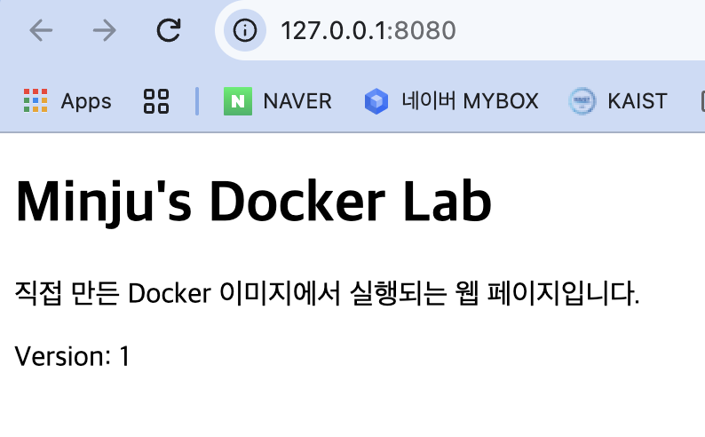
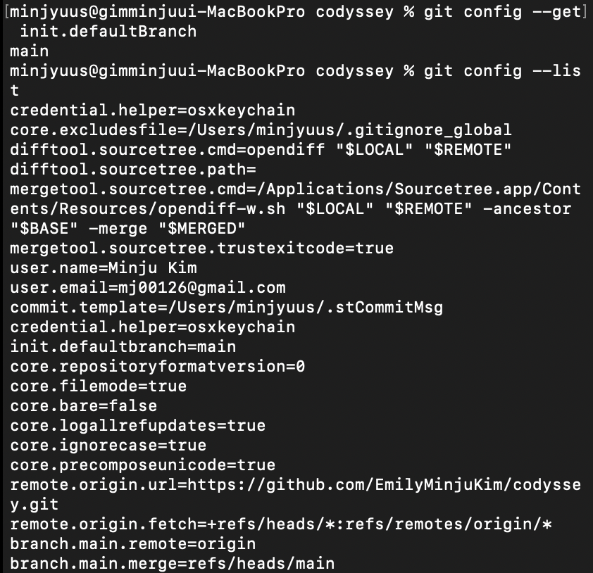
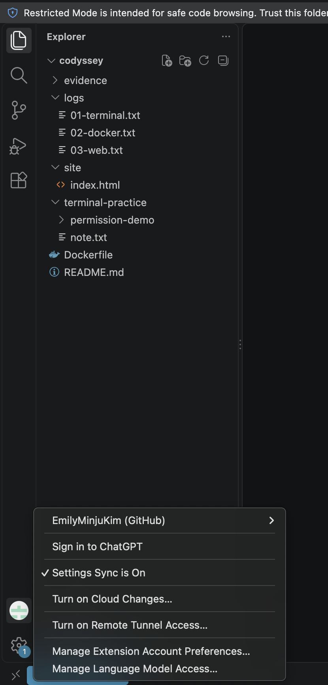
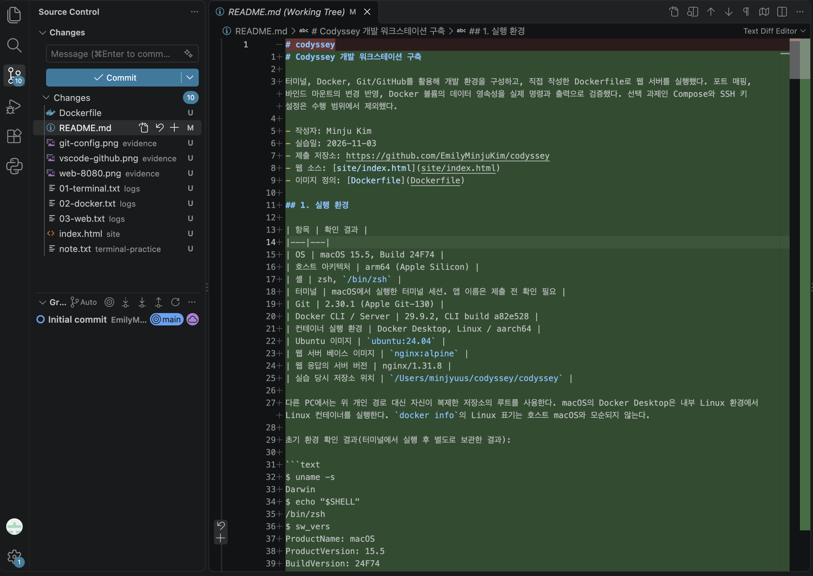

# Codyssey 개발 워크스테이션 구축

터미널, Docker, Git/GitHub를 활용해 개발 환경을 구성하고, 직접 작성한 Dockerfile로 웹 서버를 실행했다. 포트 매핑, 바인드 마운트의 변경 반영, Docker 볼륨의 데이터 영속성을 실제 명령과 출력으로 검증했다. 선택 과제인 Compose와 SSH 키 설정은 수행 범위에서 제외했다.

- 작성자: Minju Kim
- 실습일: 2026-11-03
- 제출 저장소: https://github.com/EmilyMinjuKim/codyssey
- 웹 소스: [site/index.html](site/index.html)
- 이미지 정의: [Dockerfile](Dockerfile)

## 1. 실행 환경

| 항목 | 확인 결과 |
|---|---|
| OS | macOS 15.5, Build 24F74 |
| 호스트 아키텍처 | arm64 (Apple Silicon) |
| 셸 | zsh, `/bin/zsh` |
| 터미널 | macOS 기본 Terminal.app |
| Git | 2.30.1 (Apple Git-130) |
| Docker CLI / Server | 29.9.2, CLI build a82e528 |
| 컨테이너 실행 환경 | Docker Desktop, Linux / aarch64 |
| Ubuntu 이미지 | `ubuntu:24.04` |
| 웹 서버 베이스 이미지 | `nginx:alpine` |
| 웹 응답의 서버 버전 | nginx/1.31.8 |
| 실습 당시 저장소 위치 | `/Users/minjyuus/codyssey/codyssey` |

다른 PC에서는 위 개인 경로 대신 자신이 복제한 저장소의 루트를 사용한다. macOS의 Docker Desktop은 내부 Linux 환경에서 Linux 컨테이너를 실행한다. `docker info`의 Linux 표기는 호스트 macOS와 모순되지 않는다.

초기 환경 확인 결과(터미널에서 실행 후 별도로 보관한 결과):

```text
$ uname -s
Darwin
$ echo "$SHELL"
/bin/zsh
$ sw_vers
ProductName: macOS
ProductVersion: 15.5
BuildVersion: 24F74
$ uname -m
arm64
$ git --version
git version 2.30.1 (Apple Git-130)
```

## 2. 수행 체크리스트와 증거

| 상태 | 수행 항목 | 증거 |
|---|---|---|
| 완료 | 현재 위치·목록·이동·생성·복사·이름 변경·삭제·내용 확인 | [터미널 원본 로그](logs/01-terminal.txt) |
| 완료 | 파일 및 디렉토리 권한 변경 전후 비교 | [터미널 원본 로그](logs/01-terminal.txt), 3절 |
| 완료 | Docker 버전 및 데몬 점검 | [Docker 원본 로그](logs/02-docker.txt), 4절 |
| 완료 | hello-world, Ubuntu, attach/exec, 이미지·컨테이너·로그·리소스 확인 | [Docker 원본 로그](logs/02-docker.txt), 4절 |
| 완료 | Dockerfile 직접 작성·빌드·실행 | [Dockerfile](Dockerfile), [웹 원본 로그](logs/03-web.txt) |
| 완료 | 포트 매핑 접속 | [브라우저 증거](evidence/web-8080.png), 5절 |
| 완료 | 바인드 마운트 변경 전후 비교 | [웹 원본 로그](logs/03-web.txt), 6절 |
| 완료 | 컨테이너 삭제 후 볼륨 데이터 유지 | [웹 원본 로그](logs/03-web.txt), 7절 |
| 완료 | Git 작성자·기본 브랜치·원격 저장소 설정 | [설정 증거](evidence/git-config.png) |
| 완료 | VSCode에서 폴더 열기 및 GitHub 계정 로그인 | [VSCode 증거](evidence/vscode-github.png) |
| 완료 | VSCode 소스 제어에서 저장소와 변경 파일 확인 | [소스 제어 증거](evidence/vscode-source-control.png) |
| 완료 | 최종 커밋 및 GitHub push | 로컬 HEAD와 원격 main의 커밋 값 일치 확인 |
| 완료 | 트러블슈팅 2건 이상 | 9절 |

원본 로그는 `script`로 수집했다. 터미널의 화면 제어 문자, 줄바꿈, 입력 수정 흔적, 중복 표시 및 실수로 붙여 넣은 출력이 포함되어 있다. 아래 코드블록은 실제 수행 명령과 핵심 결과를 읽기 쉽게 재구성한 발췌이며, 생략한 출력은 `...`로 표시한다. 실행 결과를 새로 생성한 것이 아니다. 이후의 **재현 절차**는 실제 기록과 구분한다.

## 3. 터미널 조작과 권한

### 기본 조작

```text
$ pwd
/Users/minjyuus/codyssey/codyssey
$ ls -la
...
.git
README.md
logs
$ mkdir terminal-practice
$ cd terminal-practice
$ pwd
/Users/minjyuus/codyssey/codyssey/terminal-practice
$ touch note.txt
$ ls -l note.txt
-rw-r--r--  1 minjyuus  staff  0 Nov  3 17:05 note.txt
$ echo 'Hello, Codyssey!' > note.txt
$ cat note.txt
Hello, Codyssey!
$ cp note.txt note-copy.txt
$ ls -l
...
-rw-r--r--  1 minjyuus  staff  17 Nov  3 17:07 note-copy.txt
-rw-r--r--  1 minjyuus  staff  17 Nov  3 17:06 note.txt
$ mv note-copy.txt renamed.txt
$ ls -l
...
-rw-r--r--  1 minjyuus  staff  17 Nov  3 17:07 renamed.txt
$ mkdir archive
$ mv renamed.txt archive/
$ ls -l archive
...
-rw-r--r--  1 minjyuus  staff  17 Nov  3 17:07 renamed.txt
$ rm archive/renamed.txt
$ ls -la archive
... (디렉토리 항목 . 및 ..만 남음)
$ rmdir archive
$ ls -la
... (archive가 삭제되고 note.txt가 남음)
```

`mkdir`, `touch`, `cp`, `mv`, `rm`, `rmdir`는 성공 시 출력이 없을 수 있어 목록 확인 명령으로 결과를 검증했다.

### 파일 권한 변경

```text
$ ls -l note.txt
-rw-r--r--  1 minjyuus  staff  17 Nov  3 17:06 note.txt
$ chmod 600 note.txt
$ ls -l note.txt
-rw-------  1 minjyuus  staff  17 Nov  3 17:06 note.txt
$ cat note.txt
Hello, Codyssey!
$ chmod 644 note.txt
$ ls -l note.txt
-rw-r--r--  1 minjyuus  staff  17 Nov  3 17:06 note.txt
```

### 디렉토리 권한 변경

```text
$ mkdir permission-demo
$ ls -ld permission-demo
drwxr-xr-x  2 minjyuus  staff  64 Nov  3 17:10 permission-demo
$ chmod 700 permission-demo
$ ls -ld permission-demo
drwx------  2 minjyuus  staff  64 Nov  3 17:10 permission-demo
$ chmod 755 permission-demo
$ ls -ld permission-demo
drwxr-xr-x  2 minjyuus  staff  64 Nov  3 17:10 permission-demo
```

권한은 소유자·그룹·그 외 사용자 순서로 해석한다. `r=4`, `w=2`, `x=1`의 합이다. `644`는 소유자 읽기/쓰기, 나머지 읽기이고, `755`는 소유자 읽기/쓰기/실행, 나머지 읽기/실행이다. 디렉토리의 `r`은 이름 목록 읽기, `w`는 항목 생성·삭제·이름 변경, `x`는 경로 탐색을 뜻한다. 실제 접근에는 상위 경로의 권한 등도 영향을 준다.

절대 경로 `/Users/minjyuus/codyssey/codyssey/terminal-practice`는 루트 `/`부터 위치를 지정한다. 상대 경로 `terminal-practice`는 현재 폴더를 기준으로 한다. `~`는 셸이 사용자 홈 경로로 확장한다.

## 4. Docker 설치 점검 및 기본 운영

개인 Mac에서 Docker Desktop을 실행하고 CLI 및 엔진을 점검했다. 설치 파일을 찾지 못했던 시도와 별개로, 아래 CLI 실행 파일 및 서버 응답으로 실제 설치 상태를 검증했다. 설치 프로그램의 모든 단계가 녹화된 것은 아니다.

```text
$ docker --version
Docker version 29.9.2, build a82e528
$ docker info
Client:
 Version:    29.9.2
 Context:    desktop-linux
...
Server:
 Containers: 0
 Images: 0
 Server Version: 29.9.2
...
 Operating System: Docker Desktop
 OSType: linux
 Architecture: aarch64
 CPUs: 8
 Total Memory: 3.825GiB
...
```

### hello-world와 이미지·컨테이너 목록

```text
$ docker run --name codyssey-hello hello-world
Unable to find image 'hello-world:latest' locally
...
Status: Downloaded newer image for hello-world:latest
Hello from Docker!
...
$ docker images
...
hello-world:latest
                  c567b231f656       22.6kB         10.3kB
$ docker ps
CONTAINER ID   IMAGE     COMMAND   CREATED   STATUS    PORTS     NAMES
$ docker ps -a
...
f645ea55703a   hello-world   "/hello"   43 seconds ago   Exited (0) 42 seconds ago   codyssey-hello
$ docker logs codyssey-hello
Hello from Docker!
...
```

`docker run`이 없는 이미지를 다운로드했다. 프로그램은 메시지를 출력하고 정상 종료했으므로 `docker ps`에는 없고 `docker ps -a`에 남았다. 이미지와 컨테이너는 별개이며, 종료된 컨테이너의 로그도 조회할 수 있다.

### Ubuntu 내부 실행 및 attach/exec 비교

```text
$ docker run -it --name codyssey-ubuntu ubuntu:24.04 bash
...
Status: Downloaded newer image for ubuntu:24.04
root@96acd629ce15:/# pwd
/
root@96acd629ce15:/# ls
bin   dev  home  media  opt   root  sbin  sys  usr
boot  etc  lib   mnt    proc  run   srv   tmp  var
root@96acd629ce15:/# echo 'Hello from Ubuntu'
Hello from Ubuntu
root@96acd629ce15:/# cat /etc/os-release
PRETTY_NAME="Ubuntu 24.04.5 LTS"
...
root@96acd629ce15:/# exit
exit
$ docker ps -a
... codyssey-ubuntu: Exited (0) ...
$ docker start codyssey-ubuntu
codyssey-ubuntu
$ docker attach codyssey-ubuntu
root@96acd629ce15:/# echo 'Attached to the main shell'
Attached to the main shell
```

Control+P, Control+Q를 순서대로 눌러 연결만 해제한 뒤 `docker ps`에서 `Up 51 seconds`를 확인했다.

```text
$ docker exec -it codyssey-ubuntu bash
root@96acd629ce15:/# echo 'Inside a separate shell'
Inside a separate shell
root@96acd629ce15:/# exit
exit
$ docker ps
... codyssey-ubuntu: Up About a minute ...
```

| 방법 | 관찰 |
|---|---|
| 처음 실행한 주 프로세스 bash에서 exit | 컨테이너 종료 |
| attach 후 분리 키 입력 | 기존 프로세스는 유지, 연결만 해제 |
| exec로 별도 bash를 실행하고 exit | 추가 셸만 종료, 주 프로세스와 컨테이너는 유지 |

### 리소스 확인과 중지

```text
$ docker stats --no-stream codyssey-ubuntu
CONTAINER ID   NAME              CPU %   MEM USAGE / LIMIT  MEM %  NET I/O        BLOCK I/O  PIDS
96acd629ce15   codyssey-ubuntu   0.00%   1.91MiB / 3.825GiB  0.05%  1.17kB / 126B  0B / 0B    1
$ docker stop codyssey-ubuntu
codyssey-ubuntu
$ docker ps
CONTAINER ID   IMAGE     COMMAND   CREATED   STATUS    PORTS     NAMES
$ docker ps -a
... codyssey-ubuntu: Exited (137) ...
```

137은 SIGKILL에 의한 종료에 대응한다. 이번에는 stop 이후 관찰됐으며, 대기 시간 초과로 강제 종료됐을 가능성이 있다. 별도 상태 검사를 하지 않았으므로 정확한 원인이나 OOM 여부는 확정하지 않았다.

## 5. Dockerfile 기반 웹 서버 및 포트 매핑

기존 웹 서버 이미지 활용 방식(A)을 선택했다. NGINX가 포함된 `nginx:alpine`을 기반으로 기본 콘텐츠를 직접 만든 HTML로 교체했다.

```dockerfile
FROM nginx:alpine
LABEL org.opencontainers.image.title="codyssey-web"
COPY site/ /usr/share/nginx/html/
EXPOSE 80
```

| 커스텀 항목 | 목적 |
|---|---|
| LABEL | 프로젝트 제목을 이미지 메타데이터로 표시 |
| COPY | 직접 작성한 웹 페이지를 이미지 안에 포함 |
| EXPOSE 80 | 서비스가 사용하는 컨테이너 포트를 명시 |

EXPOSE 자체는 호스트 포트를 공개하지 않는다. `-p`로 호스트 포트와 컨테이너 포트를 연결해야 Mac에서 접속할 수 있다. `127.0.0.1`에 바인딩하여 로컬 접속으로 제한했다.

```text
$ docker build -t codyssey-web:1.0 .
...
[+] Building 6.4s (8/8) FINISHED     docker:desktop-linux
...
=> => naming to docker.io/library/codyssey-web:1.0  0.0s
$ docker run -d --name codyssey-web -p 127.0.0.1:8080:80 codyssey-web:1.0
e66ef830e37323e7378a4f6d1c76a44f404bed6ec775d30600987549e72d667e
$ docker ps
... 127.0.0.1:8080->80/tcp ... codyssey-web
$ curl -i http://127.0.0.1:8080
HTTP/1.1 200 OK
Server: nginx/1.31.8
...
  <h1>Minju's Docker Lab</h1>
  <p>직접 만든 Docker 이미지에서 실행되는 웹 페이지입니다.</p>
  <p>Version: 1</p>
...
```

주소창과 응답 화면을 함께 촬영했다.



## 6. 바인드 마운트 변경 반영

```bash
docker run -d --name codyssey-web-bind -p 127.0.0.1:8081:80 --mount "type=bind,source=$(pwd)/site,target=/usr/share/nginx/html,readonly" codyssey-web:1.0
```

컨테이너 ID `edc2198d26457de409380cbe9838b6b4046fe143a12a0f33d5a521da61cc28a6`이 반환됐다. `$(pwd)/site`를 읽기 전용으로 연결했다. 컨테이너에서의 쓰기는 제한하지만 호스트에서는 파일을 수정할 수 있다.

```text
$ curl http://127.0.0.1:8081
...
  <p>Version: 1</p>
...
$ sed -i '' 's/Version: 1/Version: 2/' site/index.html
$ cat site/index.html
...
  <p>Version: 2</p>
...
$ curl http://127.0.0.1:8081
...
  <p>Version: 2</p>
...
$ curl http://127.0.0.1:8080
...
  <p>Version: 1</p>
...
```

이미지를 다시 빌드하거나 컨테이너를 재시작하지 않았다. 마운트한 8081은 호스트 파일의 변경을 반영했고, 8080은 빌드 시 복사한 파일을 유지했다. 마운트는 대상 위치의 이미지 파일을 가려서 호스트 폴더가 보이도록 한다.

## 7. Docker 볼륨 영속성

```text
$ docker volume create codyssey-data
codyssey-data
$ docker run -d --name codyssey-vol1 --mount type=volume,source=codyssey-data,target=/data ubuntu:24.04 sleep infinity
61a489553de7a1454de2f0563500d092954dbe327489eebc8c7aabac7487be2b
$ docker exec codyssey-vol1 bash -c 'echo "Volume data survives" > /data/proof.txt'
$ docker exec codyssey-vol1 cat /data/proof.txt
Volume data survives
$ docker rm -f codyssey-vol1
codyssey-vol1
$ docker run -d --name codyssey-vol2 --mount type=volume,source=codyssey-data,target=/data ubuntu:24.04 sleep infinity
95f46477ce0f1f41377264c6cd660025baea52d3415f1311dfd18372dbc0b030
$ docker exec codyssey-vol2 cat /data/proof.txt
Volume data survives
```

서로 다른 ID의 컨테이너에서 동일한 데이터를 읽었다.

볼륨은 Docker가 관리하는 저장소다. 이름 있는 볼륨을 삭제하지 않고 새 컨테이너에 다시 연결했으므로 데이터를 새로 쓰지 않아도 읽을 수 있었다. 바인드 마운트는 직접 지정한 호스트 경로를 공유한다는 점에서 다르다. 컨테이너 내부의 일반 쓰기 계층은 컨테이너 삭제와 함께 사라지지만, 여기서 사용한 이름 있는 볼륨은 별도로 유지된다.

## 8. Git 및 GitHub / VSCode

Git은 로컬 파일의 변경 이력을 기록하며, GitHub는 원격 저장소를 통해 공유·협업하는 플랫폼이다. 이름과 이메일은 커밋 작성자 정보이고 GitHub 로그인 자격증명은 아니다.

기존 작성자 설정을 유지하고 새 저장소 기본 브랜치를 설정했다.

```bash
git config --global init.defaultBranch main
git config --get init.defaultBranch
git config --list
```

아래는 실제 출력의 주요 항목이다. 본문에서는 이메일을 가렸다. 원본 설정 스크린샷에는 이메일과 사용자 경로가 표시되어 있으므로 공개 범위를 확인한다.

```text
main
...
credential.helper=osxkeychain
user.name=Minju Kim
user.email=[마스킹]
init.defaultbranch=main
remote.origin.url=https://github.com/EmilyMinjuKim/codyssey.git
remote.origin.fetch=+refs/heads/*:refs/remotes/origin/*
branch.main.remote=origin
branch.main.merge=refs/heads/main
```



```bash
cd ~/codyssey/codyssey
open -a "Visual Studio Code" .
```

VSCode에서 과제 폴더를 열었고, 계정 메뉴에 `EmilyMinjuKim (GitHub)`가 표시된다.



VSCode 소스 제어에서 저장소와 변경 파일이 표시되는 것을 확인했다.



최종 커밋을 GitHub에 업로드했다. 전송 중 HTTP 400 오류가 발생했으나, 아래 명령으로 재시도한 뒤 로컬 HEAD와 원격 main의 커밋 값이 일치하는 것을 확인했다.

```bash
git -c credential.helper= -c http.postBuffer=5242880 push origin main
git rev-parse HEAD
git -c credential.helper= ls-remote origin refs/heads/main
```

버퍼 변경 후 전송에 성공했지만, 오류의 정확한 원인까지 확정한 것은 아니다.

## 9. 트러블슈팅

### 1) Docker 앱은 있지만 명령어를 찾지 못함

- 문제: `docker --version`에 `zsh: command not found: docker` 발생.
- 원인 가설: 설치 누락 또는 CLI 경로가 PATH에 포함되지 않음.
- 확인: `/Applications/Docker.app/Contents/Resources/bin/docker`가 존재하며 전체 경로로 실행하자 버전 29.9.2가 출력됨.
- 해결: 아래처럼 경로를 추가한 뒤 일반 명령으로 버전과 서버를 확인함.

```bash
export PATH="/Applications/Docker.app/Contents/Resources/bin:$PATH"
docker --version
docker info
echo 'export PATH="/Applications/Docker.app/Contents/Resources/bin:$PATH"' >> ~/.zshrc
zsh -ic 'docker --version'
```

마지막 명령에서도 `Docker version 29.9.2, build a82e528`이 출력됐다. `.zshrc` 추가는 한 번 수행했으며 재현 시 이미 설정되어 있으면 중복 추가하지 않는다. [근거](logs/02-docker.txt)

### 2) 디렉토리 이름의 하이픈 누락

- 문제: `ls -ld permission demo` 실행 시 두 경로 모두 `No such file or directory` 발생.
- 원인 가설: 실제 이름과 입력한 이름이 다름.
- 확인: `ls`로 `permission-demo`가 존재함을 확인.
- 해결: `ls -ld permission-demo`로 다시 실행하여 `drwxr-xr-x` 확인.
- 학습: 공백은 인수를 나누므로 두 개의 경로로 해석됐다. [근거](logs/01-terminal.txt)

### 3) 존재하지 않는 컨테이너에 exec 실행

- 문제: `No such container: codyssey-vol1` 발생.
- 원인 가설: 생성하지 않았거나 생성에 실패한 컨테이너 이름을 사용함.
- 확인: `docker ps -a`에 해당 이름이 없었음.
- 해결: 볼륨과 `codyssey-vol1`을 생성한 뒤 쓰기/읽기 성공. 삭제 후 `codyssey-vol2`로 같은 데이터 읽기까지 완료.
- 한계: 처음 생성 명령을 생략했는지 실패했는지까지는 확정하지 않음. [근거](logs/03-web.txt)

### 4) 따옴표 입력 대기

- 문제: 문자열 입력 후 `dquote>` 프롬프트로 전환됨.
- 원인 가설: 셸이 닫히지 않은 큰따옴표를 기다리는 상태. 정확한 입력 원인은 확정하지 않음.
- 확인/해결: Control+C로 취소하고 `echo 'Hello, Codyssey!' > note.txt`를 다시 실행한 뒤 `cat`으로 내용 확인.
- 학습: 작은따옴표 안에서는 문자열을 문자 그대로 취급한다. [근거](logs/01-terminal.txt)

## 10. 평가자용 재현 절차

이 절차는 **새로 복제한 작업 폴더와 사용하지 않는 컨테이너 이름·포트**를 전제로 한다. 아래는 재실행 안내이며 새로운 실행 증거는 아니다. Docker Desktop을 먼저 실행한다. 8080/8081이 사용 중이면 다른 호스트 포트로 변경하고 curl 주소도 함께 변경한다. 기존 실습 컨테이너를 임의로 삭제할 필요는 없다.

```bash
git clone https://github.com/EmilyMinjuKim/codyssey.git codyssey-check
cd codyssey-check
docker --version
docker info
```

최종 소스는 Version 2다. 그대로 빌드하면 두 서버 모두 처음부터 Version 2를 반환한다. 실습의 Version 1 → 2 비교를 재현하기 위해 **새 복제본에서만** 먼저 Version 1로 되돌린다.

```bash
# macOS용 sed 문법
sed -i '' 's/Version: 2/Version: 1/' site/index.html
docker build -t codyssey-web:verify .
docker run -d --name codyssey-check-web -p 127.0.0.1:8080:80 codyssey-web:verify
docker run -d --name codyssey-check-bind -p 127.0.0.1:8081:80 --mount "type=bind,source=$(pwd)/site,target=/usr/share/nginx/html,readonly" codyssey-web:verify
curl -i http://127.0.0.1:8080
curl http://127.0.0.1:8081
sed -i '' 's/Version: 1/Version: 2/' site/index.html
curl http://127.0.0.1:8081
curl http://127.0.0.1:8080
```

예상 결과: 변경 전에는 둘 다 Version 1, 변경 후에는 8081이 Version 2, 8080이 Version 1을 반환한다.

Linux의 GNU sed에서는 `sed -i ''` 대신 `sed -i`를 사용한다.

볼륨 검증은 사용하지 않는 이름으로 반복한다.

```bash
docker volume create codyssey-check-data
docker run -d --name codyssey-check-vol1 --mount type=volume,source=codyssey-check-data,target=/data ubuntu:24.04 sleep infinity
docker exec codyssey-check-vol1 bash -c 'echo "Volume data survives" > /data/proof.txt'
docker exec codyssey-check-vol1 cat /data/proof.txt
docker rm -f codyssey-check-vol1
docker run -d --name codyssey-check-vol2 --mount type=volume,source=codyssey-check-data,target=/data ubuntu:24.04 sleep infinity
docker exec codyssey-check-vol2 cat /data/proof.txt
```

두 cat 명령이 동일한 문자열을 반환해야 한다. 이 절차는 컨테이너만 삭제하며 볼륨은 삭제하지 않는다.

`nginx:alpine`과 `ubuntu:24.04`는 변경 가능한 태그이므로 향후 다운로드 시 패키지 버전과 이미지 ID가 달라질 수 있다. 이 과제는 실행 동작의 재현을 확인했으며 이미지 바이트 단위 동일성까지 보장하지 않는다.

## 11. 핵심 정리

- 이미지는 실행에 필요한 파일과 설정의 기반이고, 컨테이너는 그 이미지로 만든 실행 인스턴스다. 한 이미지에서 여러 컨테이너를 만들 수 있다.
- 프로세스·네트워크·파일시스템이 분리되므로 외부 접근에는 포트 매핑, 파일 공유에는 마운트 설정이 필요하다.
- 바인드 마운트는 개발 중 호스트 파일 변경을 바로 반영할 때 적합하다.
- 볼륨은 컨테이너 교체와 독립적으로 유지할 데이터를 저장하는 데 사용한다.
- Git commit은 로컬 이력 저장이고 push는 그 커밋을 원격 저장소에 전송하는 작업이다.
